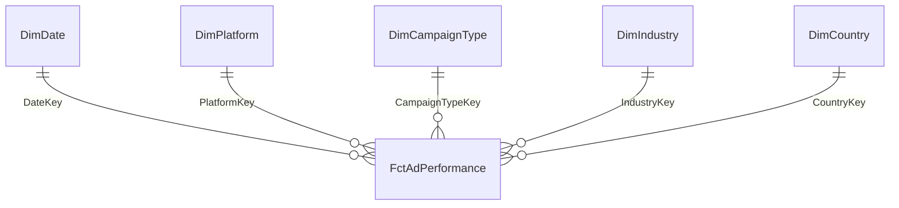

# NEXORA Data Warehouse

Data Mart quảng cáo dùng dbt Core + PostgreSQL, theo luồng Raw → Staging → Intermediate → Mart. Giữ nguyên Raw hiện có, bảo toàn mỗi dòng nguồn và cung cấp Star Schema cho Power BI/DSS.

## Environments

| Target | Database | Schema đích |
|---|---|---|
| `local` (mặc định) | PostgreSQL loopback, mặc định cổng 55432/database `nexora` | `{staging,intermediate,mart,mapping}` |
| `dev` | Supabase hiện có qua `DATABASE_URL` trong `.env` | `{staging,intermediate,mart,mapping}` |

Local không sử dụng `DATABASE_URL`. Không đổi cấu hình Supabase hoặc bảng `raw.global_ads_performance`. dbt dùng tên chuẩn `dbt_project.yml`.

## Data Models

| Model | Layer / materialization | Chức năng |
|---|---|---|
| `stg_ads_performance` | Staging / view | Cast nghiêm ngặt, giữ KPI nguồn và ID truy vết |
| `int_ads_performance` | Intermediate / view | Tính lại CTR, CPC, CPA, Conversion Rate, ROAS |
| `fct_ad_performance` → `FctAdPerformance` | Mart / table | ID, 5 FK nguyên và 5 additive measures |
| `dim_date` → `DimDate` | Mart / table | Lịch liên tục từ min đến max ngày nguồn; khóa YYYYMMDD |
| `dim_platform` → `DimPlatform` | Mart / table | Nền tảng quảng cáo |
| `dim_campaign_type` → `DimCampaignType` | Mart / table | Loại chiến dịch |
| `dim_industry` → `DimIndustry` | Mart / table | Ngành |
| `dim_country` → `DimCountry` | Mart / table | Quốc gia |

## Data Quality Tests

| Test Group | Kiểm tra | Mục đích |
|---|---|---|
| Integrity | PK, NULL, số dòng các lớp, grain từng dòng | Không mất/nhân dòng |
| Validity | Định dạng, cast, non-negative, quy tắc notebook | Không che giấu dữ liệu lỗi |
| Relationships | 5 FK → Dimension | Không có orphan |
| Reconciliation | Raw ↔ Fact, từng dòng, tổng và từng chiều | Measures và KPI tổng hợp khớp |
| KPI | CTR ±0,00005; CPC/CPA/ROAS ±0,005; chia 0 → NULL | Phát hiện sai lệch theo precision CSV |
| Reliability | Snapshot toàn bộ Mart và Raw trước/sau rebuild | IDs ổn định, Raw không đổi |

CTR mismatch là **WARN**; các vi phạm khác là **ERROR**. `store_failures` mặc định tắt: test không lưu bảng lỗi hoặc tạo schema audit. Có thể bật khi cần bằng `--store-failures`. Chi tiết quy tắc và kết quả: [docs/testing.md](docs/testing.md).

## How to Run

Từ repository root, `uv sync` rồi kích hoạt `.venv`. PostgreSQL local phải chạy, database và user phải tồn tại; cấu hình qua `LOCAL_PG*` (xem `.env.example`, export các biến tùy chỉnh vào shell).

Nếu local chưa có Raw, tái sử dụng loader hiện có, chỉ định URL local rõ ràng:

```bash
DATABASE_URL=postgresql://nexora@127.0.0.1:55432/nexora python scripts/load_raw_to_postgres.py
python scripts/dbt_warehouse.py debug --target local
python scripts/dbt_warehouse.py build --target local
python scripts/dbt_warehouse.py test --target local
python scripts/verify_warehouse.py --target local
python scripts/dbt_warehouse.py debug --target dev
```

Wrapper chạy dbt chuẩn, tự truyền `--project-dir`, `--profiles-dir`, và chuyển `DATABASE_URL` thành biến môi trường cho profile Dev mà không ghi credentials ra file. Có thể dùng trực tiếp từ `dbt-modeling/` với `export DBT_PROFILES_DIR="$PWD"`:

```bash
dbt debug --target local
dbt build --target local
dbt test --target local
# Dev trực tiếp cần export DBT_DEV_HOST/PORT/USER/PASSWORD/DATABASE trước.
dbt debug --target dev
dbt build --target dev
```

Trước **mỗi lần triển khai Dev có thay đổi**, kiểm tra host/project trong `.env`, database, Raw, quyền CREATE và các đối tượng/dependencies trong schema đích. Sau khi xác minh, export `NEXORA_DEV_VERIFIED=HOST/DATABASE` khớp chính xác kết nối rồi chạy:

```bash
python scripts/dbt_warehouse.py build --target dev
python scripts/verify_warehouse.py --target dev
```

Build thay thế các bảng Mart do project quản lý; không dùng chung schema đích với ứng dụng khác. Không chạy full-refresh hoặc xóa bảng `mapping.source_rows`. Không chạy đồng thời các lệnh dbt trong project vì chúng dùng chung artifacts.

## Star Schema



## Important Notes

- Grain kỹ thuật: **mỗi dòng Raw → một dòng Fact**, không suy diễn campaign grain khi thiếu Campaign ID. Giữ cả 24 dòng thuộc 12 tổ hợp chiều lặp.
- Raw không có ID: bảng `mapping.source_rows` cấp BIGINT identity một lần theo thứ tự payload xác định, đối chiếu nguyên payload JSONB bằng equality, không hash/UUID/ctid/khóa text ghép. Giữ bảng này và backup cùng Mart để bảo toàn Fact IDs. IDs ổn định trong từng môi trường; không đảm bảo giống nhau giữa hai môi trường được khởi tạo độc lập.
- Đã xác minh không có dòng trùng hoàn toàn. Nếu xuất hiện, test sẽ ERROR; cần bổ sung ID tại nguồn trước khi hỗ trợ các dòng hoàn toàn giống nhau. Không deduplicate Fact. Raw thay đổi nội dung tạo ID mới; đây không phải cơ chế CDC.
- Schema `mapping` giữ bảng `source_rows` và seeds `map_*` để cấp IDs ổn định.
- Dimension keys là mapping CSV được version control. Khi thêm giá trị, **append ID mới chưa dùng**, không đánh số lại hoặc tái sử dụng ID đã cấp. Giá trị chưa mapping làm test FK NOT NULL thất bại.
- Tiền dùng NUMERIC chính xác, không thay NULL bằng 0, không làm tròn sớm. KPI tổng hợp = `SUM(tử số) / NULLIF(SUM(mẫu số), 0)`; không AVG các tỷ lệ. CTR/Conversion Rate là tỷ lệ 0–1; nguồn không có Conversion Rate.
- Snapshot hiện tại: 1.800 dòng, 47 CTR lệch chưa rõ nguyên nhân; giữ outlier và ngày không có quảng cáo, không tự sinh Fact bằng 0. `expected_source_rows` mặc định 1800; chỉ đổi khi xác nhận snapshot mới.

### Tên Mart

Bảng và cột Mart dùng PascalCase: `DimDate`, `DimPlatform`, `DimCampaignType`, `DimIndustry`, `DimCountry`, `FctAdPerformance`; ví dụ `FactId`, `DateKey`, `AdSpend`. Schema vẫn là `mart`. Tên file/model và `ref()` giữ snake_case để bảo toàn tích hợp dbt. PostgreSQL cần dấu ngoặc kép khi truy vấn: `select "AdSpend" from mart."FctAdPerformance"`.
