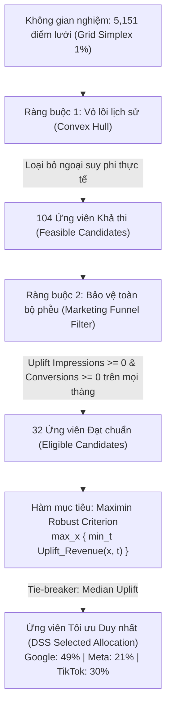

# BÁO CÁO THẤU HIỂU TOÀN DIỆN DỰ ÁN NEXORA — GLOBAL AD SPEND & DSS

---

## 1. TỔNG QUAN DỰ ÁN (PROJECT OVERVIEW)

### 1.1. Bối cảnh & Mục tiêu kinh doanh
Dự án **NEXORA — Global Ad Spend** là một nền tảng phân tích dữ liệu hiệu suất tiếp thị đa kênh (Marketing Analytics) kết hợp **Hệ thống Hỗ trợ Ra Quyết định (Decision Support System - DSS)**. Dự án được thiết kế nhằm giải quyết bài toán cốt lõi của các doanh nghiệp kinh doanh toàn cầu:
1. **Minh bạch hóa & Đánh giá hiệu suất quảng cáo**: Giám sát chi tiêu (Ad Spend), Doanh thu (Revenue), Tỷ suất hoàn vốn quảng cáo (ROAS), Chi phí trên mỗi lượt nhấp/chuyển đổi (CPC, CPA) và tỷ lệ chuyển đổi (CTR, CVR) xuyên suốt 3 nền tảng quảng cáo lớn: **Google Ads**, **Meta Ads**, và **TikTok Ads**.
2. **Khai phá các điểm tăng trưởng (Growth Pockets)**: Xác định các tổ hợp phân khúc thị trường ngách có hiệu suất vượt trội (Tổ hợp Nền tảng × Quốc gia × Loại chiến dịch) đang bị đầu tư dưới mức tiềm năng.
3. **Tối ưu hóa phân bổ ngân sách dựa trên dữ liệu lịch sử (DSS Budget Allocation)**: Xây dựng thuật toán phân bổ ngân sách tối ưu, ứng dụng lý thuyết trò chơi/ra quyết định bền vững (Robust Maximin Decision Rule), đảm bảo không vượt quá biên lịch sử (Convex Hull), đồng thời bảo vệ toàn bộ phễu chuyển đổi (Impressions và Conversions không suy giảm).
4. **Kiến trúc dữ liệu tiêu chuẩn công nghiệp (Enterprise Data Architecture)**: Dữ liệu được tổ chức theo mô hình Medallion (Raw → Staging → Intermediate → Mart), kiểm soát chất lượng nghiêm ngặt bằng dbt, lưu trữ trên PostgreSQL, tính toán DSS bằng Python và trực quan hóa trực tiếp trên Power BI qua định dạng PBIP hiện đại.

---

## 2. KIẾN TRÚC HỆ THỐNG TỔNG THỂ (SYSTEM ARCHITECTURE)

Dự án vận hành theo một luồng dữ liệu khép kín, tự động hóa từ tập tin thô đến bảng điều khiển tương tác:

```mermaid
flowchart TD
    subgraph S1["1. Data Ingestion & Storage"]
        CSV["data/raw/*.csv<br/>1,800 dòng"] -->|load_raw_to_postgres.py| PG_RAW["PostgreSQL Schema: raw<br/>global_ads_performance<br/>(100% TEXT, Raw Data)"]
    end

    subgraph S2["2. Data Warehouse & Transformation (dbt-core)"]
        PG_RAW -->|prepare_source_ids macro| MAP["Schema: mapping<br/>source_rows<br/>(JSONB Hashless ID)"]
        PG_RAW & MAP --> STG["Schema: staging<br/>stg_ads_performance (View)<br/>Strict Type Casting"]
        STG --> INT["Schema: intermediate<br/>int_ads_performance (View)<br/>KPI Calculations"]
        INT --> MARTS["Schema: mart (Tables)<br/>Star Schema:<br/>- FctAdPerformance<br/>- DimDate, DimPlatform<br/>- DimCampaignType, DimIndustry<br/>- DimCountry"]
        INT --> DSS_MONTHLY["Schema: mart (Table)<br/>DssMonthly<br/>Platform × Month (2024)<br/>36 States"]
    end

    subgraph S3["3. Decision Support System (Python DSS Engine)"]
        DSS_MONTHLY -->|run_dss.py / dss.engine| ENGINE["DSS Engine<br/>- 5,151 Grid Points<br/>- 2D Convex Hull Feasibility<br/>- Funnel Preservation Filter<br/>- Robust Maximin Optimizer<br/>- 6-Fold OOT Validation<br/>- Concavity Stress Test"]
        ENGINE -->|dss.storage (ACID Transaction)| DSS_SCHEMA["Schema: dss (PostgreSQL)<br/>- runs (Summary & Fingerprint)<br/>- allocations<br/>- scenarios<br/>- validation<br/>- sensitivity<br/>- history<br/>- executions"]
    end

    subgraph S4["4. Business Intelligence & Decision Viz (Power BI)"]
        MARTS -->|Direct / Import Connection| PBI_MODEL["Power BI Semantic Model (TMDL)<br/>Star Schema + DSS Extension"]
        DSS_SCHEMA -->|run_id Relationship| PBI_MODEL
        PBI_MODEL --> PBI_PAGES["Report Pages (.pbip):<br/>1. Growth Overview<br/>2. Growth Funnel<br/>3. Growth Opportunity (OLS Regression)<br/>4. Budget Allocation Decision (DSS)<br/>5. Strategy Comparison (OOT Folds)"]
    end
```

---

## 3. TẬP DỮ LIỆU NGUỒN & PHÂN TÍCH CHẤT LƯỢNG (DATA QUALITY & EDA)

### 3.1. Đặc tính tập dữ liệu gốc
- **Tập tin nguồn**: `data/raw/global_ads_performance_dataset.csv`.
- **Kích thước**: 1.800 dòng dữ liệu, 14 cột, không có giá trị NULL.
- **Thời gian bao phủ**: Toàn bộ năm 2024 (từ 01/01/2024 đến 30/12/2024, có dữ liệu 360/365 ngày).
- **Phân loại các chiều nghiệp vụ**:
  - `platform` (3 nền tảng): Google Ads (84,11% ngày), Meta Ads (84,38% ngày), TikTok Ads (70,68% ngày).
  - `campaign_type` (4 loại): Search, Display, Video, Shopping.
  - `industry` (5 ngành): E-commerce, EdTech, Fintech, Healthcare, SaaS.
  - `country` (7 quốc gia): Australia, Canada, Germany, India, UAE, UK, USA.
- **Các chỉ số định lượng gốc (Measures)**: `impressions`, `clicks`, `ad_spend`, `conversions`, `revenue`.
- **Các KPI tính toán sẵn trong file**: `CTR`, `CPC`, `CPA`, `ROAS`.

### 3.2. Những phát hiện sâu sắc từ EDA (`notebooks/01_data_quality.ipynb`)
1. **Thiếu Khóa chính nguồn (No Primary Key)**:
   - File CSV không có cột `id` hay `campaign_id`.
   - Nếu dùng tổ hợp 5 chiều nghiệp vụ (`date`, `platform`, `campaign_type`, `industry`, `country`), chỉ có **1.788 tổ hợp duy nhất**, có **12 tổ hợp xuất hiện 2 lần (liên quan 24 bản ghi)**.
   - Kiểm tra kỹ cho thấy các dòng này **không trùng lặp 100% payload** (các chỉ số chi tiêu, hiển thị khác nhau). Điều này chứng minh doanh nghiệp chạy nhiều nhóm quảng cáo/chiến dịch khác nhau trong cùng một ngày/ngành/quốc gia. Nếu tự ý loại bỏ (deduplicate) theo 5 chiều, warehouse sẽ mất 0,67% số dòng, làm sai lệch hơn $108.000 chi phí quảng cáo và $563.000 doanh thu. Do đó, quy tắc kiến trúc bắt buộc: **Bảo tồn 100% 1.800 dòng nguồn**.
2. **Sai lệch làm tròn của CTR (The 47 CTR Discrepancies)**:
   - Các KPI `CPC`, `CPA`, `ROAS` khớp hoàn hảo với công thức tính lại (100% trong ngưỡng sai số $\pm 0.005$).
   - Tuy nhiên, có **47/1.800 dòng (2,61%)** có `CTR` lệch quá $\pm 0.00005$ so với `clicks / impressions` (độ lệch tối đa ~ 0,000177).
   - Phát hiện tập trung: 70,73% sai lệch nằm ở nhóm có impressions nhỏ (< 10.000).
   - Giải pháp kiến trúc: Không tự ý sửa dữ liệu thô. dbt đặt test `kpi_ctr` ở mức độ **WARN**, giữ nguyên trường thô `source_ctr` ở Staging để đối soát, nhưng tại Intermediate và Mart, mọi KPI tỷ lệ đều được tính lại từ tổng các measures gốc.

---

## 4. CHI TIẾT DATA WAREHOUSE & DBT MODELING

Kho dữ liệu được tổ chức theo chuẩn dbt-core kết hợp PostgreSQL, phân chia 4 schema chuyên biệt: `raw` → `mapping` → `staging` → `intermediate` → `mart`.

### 4.1. Cơ chế cấp ID định danh không phá hủy (`mapping.source_rows`)
Do Raw không có PK, nếu dùng hàm hash MD5/SHA256 thì nguy cơ collision hoặc chuỗi text cồng kềnh, nếu dùng sequence thông thường thì khi dbt rebuild sẽ sinh lại ID mới làm vỡ quan hệ downstream.
- **Giải pháp thiết kế độc đáo**: Macro dbt `prepare_source_ids()` được kích hoạt tự động qua hook `on-run-start`:
  ```sql
  create table if not exists mapping.source_rows (
      source_row_id bigint generated always as identity primary key,
      payload jsonb not null unique
  );
  insert into mapping.source_rows (payload)
  select distinct to_jsonb(r) as payload from raw.global_ads_performance r
  where not exists (select 1 from mapping.source_rows m where m.payload = to_jsonb(r))
  order by payload
  on conflict (payload) do nothing;
  ```
- Toàn bộ nội dung mỗi dòng Raw được ép kiểu sang `JSONB`. Nhờ đó, mỗi dòng dữ liệu duy nhất được cấp một `source_row_id` dạng `BIGINT` vĩnh viễn, cố định, bảo đảm tính bất biến (idempotent) qua mọi lần build lại warehouse.

### 4.2. Các tầng mô hình hóa dbt

| Model dbt | Schema vật lý | Dạng vật lý | Chức năng chính |
|---|---|---|---|
| `stg_ads_performance` | `staging` | View | Join với `mapping.source_rows`, ép kiểu dữ liệu nghiêm ngặt (strict cast), lưu giữ KPI nguồn và các trường thô. |
| `int_ads_performance` | `intermediate` | View | Tính toán lại chuẩn xác: `ctr`, `cpc`, `cpa`, `conversion_rate` (nguồn không có), `roas` với bẫy lỗi mẫu số 0: `nullif(..., 0)`. |
| `dim_date` (`DimDate`) | `mart` | Table | Bảng lịch liên tục 365 ngày (2024), PK: `DateKey` (YYYYMMDD), Day, Month, MonthName, Quarter, Year. |
| `dim_platform` (`DimPlatform`) | `mart` | Table | 3 nền tảng quảng cáo (Google Ads, Meta Ads, TikTok Ads) từ seed `map_platform.csv`. |
| `dim_campaign_type` (`DimCampaignType`) | `mart` | Table | 4 loại chiến dịch (Display, Search, Shopping, Video) từ seed `map_campaign_type.csv`. |
| `dim_industry` (`DimIndustry`) | `mart` | Table | 5 ngành từ seed `map_industry.csv`. |
| `dim_country` (`DimCountry`) | `mart` | Table | 7 quốc gia từ seed `map_country.csv`. |
| `fct_ad_performance` (`FctAdPerformance`) | `mart` | Table | Bảng Fact Star Schema chuẩn: `FactId` (PK), 5 FK nguyên (`DateKey`, `PlatformKey`, v.v.) và 5 Additive Measures (`Impressions`, `Clicks`, `AdSpend`, `Conversions`, `Revenue`). |
| `dss_monthly` (`DssMonthly`) | `mart` | Table | Mart tổng hợp chuyên biệt cho DSS: Grain **Platform × Month** trong năm 2024 (chuẩn 36 dòng), tính sẵn các tỷ lệ hiệu quả trên mỗi đơn vị chi phí: `RevenuePerDollar`, `ImpressionsPerDollar`, `ConversionsPerDollar`. |

> **Quy ước đặt tên**: Tại database vật lý PostgreSQL, tầng Mart sử dụng định dạng **PascalCase** (`FctAdPerformance`, `DimDate`, v.v.), trong khi tên file dbt và lệnh `ref()` giữ nguyên **snake_case**.

### 4.3. Chiến lược kiểm thử tự động (Data Quality Testing Framework)
Dự án thiết lập một hệ thống 68 kiểm thử tự động cực kỳ khắt khe:
1. **Kiểm tra toàn vẹn (Integrity Tests)**: Đảm bảo số dòng các tầng khớp tuyệt đối với Raw (1.800 dòng), không có dòng nào bị mất hoặc bị nhân bản (`tests/layer_counts.sql`).
2. **Kiểm tra quan hệ (Referential Integrity)**: 5 FK của bảng Fact đều có quan hệ 100% với Dimension, không có orphan record nào (`relationships` tests).
3. **Đối soát chính xác (Reconciliation Tests)**: Đối soát tổng số dòng và tổng giá trị của 5 chỉ số đo lường giữa `raw.global_ads_performance` và `mart.FctAdPerformance` bằng kiểu số `NUMERIC`, chênh lệch phải bằng **0.00**.
4. **Kiểm tra tính hợp lệ dữ liệu (Validity Tests)**: Đảm bảo không có chi phí/doanh thu âm, `clicks <= impressions`, `CTR` nằm trong khoảng $[0, 1]$.
5. **Kiểm tra snapshot xây dựng lại (`scripts/verify_warehouse.py`)**: Script tự động snapshot toàn bộ Raw và Fact/Dim, chạy lại `dbt build`, sau đó so sánh từng byte dữ liệu để chứng minh Raw không bị sửa đổi và ID không bị biến động.

---

## 5. DECISION SUPPORT SYSTEM (DSS) — CƠ CHẾ TOÁN HỌC & MÔ PHỎNG PHÂN BỔ NGÂN SÁCH

Hệ thống DSS (`dss/engine.py` và `dss/storage.py`) là trái tim thuật toán của dự án, được thiết kế để tìm kiếm phương án phân bổ ngân sách tối ưu giữa **Google**, **Meta**, và **TikTok**.

### 5.1. Định nghĩa bài toán
- Giả sử tổng ngân sách tiếp thị hàng tháng $B$ được cố định ở mức trung bình của Quý 4/2024.
- Cần tìm vector tỷ trọng ngân sách $\mathbf{x} = [x_G, x_M, x_T]^T$ thỏa mãn:
  $$x_G + x_M + x_T = 1 \quad \text{và} \quad x_i \ge 0$$
- Phương án hiện tại (Baseline $\mathbf{x}_0$): Tỷ trọng chi tiêu thực tế bình quân trong Q4/2024.

### 5.2. Thuật toán tối ưu hóa Maximin bền vững (Robust Maximin Optimizer)



1. **Sinh lưới ứng viên (Candidate Grid Generation)**:
   - Sinh lưới đều trên Simplex với bước nhảy 1 điểm phần trăm (1 pp):
     $$\mathbf{x} \in \left\{ (g, m, 100 - g - m)/100 \mid g \in [0, 100], m \in [0, 100-g] \right\}$$
   - Tổng cộng có $\frac{101 \times 102}{2} = \mathbf{5.151}$ phương án phân bổ.
2. **Ràng buộc Hỗ trợ Lịch sử qua Vỏ Lồi (Convex Hull Support)**:
   - Các doanh nghiệp thường gặp rủi ro khi mô hình gợi ý tỷ trọng chưa từng được thử nghiệm trong quá khứ.
   - DSS tính toán **2D Convex Hull** (sử dụng thư viện `scipy.spatial.ConvexHull`) từ 12 điểm tỷ trọng chi tiêu thực tế của 12 tháng năm 2024.
   - Mọi phương án phân bổ bắt buộc phải nằm bên trong hoặc trên biên của Convex Hull. Bộ lọc này loại bỏ 5.047 phương án, chỉ giữ lại **104 phương án khả thi**.
3. **Bộ lọc Bảo toàn Phễu chuyển đổi (Funnel Preservation Filter)**:
   - Tối ưu doanh thu không được đánh đổi bằng việc làm sụp đổ lưu lượng truy cập hoặc khách hàng tiềm năng.
   - Ứng viên phải bảo đảm trong **tất cả 12 tháng lịch sử**, doanh số hiển thị (Impressions) và số lượng chuyển đổi (Conversions) mô phỏng không được thấp hơn Baseline:
     $$\min_{t \in \{1..12\}} \text{Uplift}_{\text{Impression}}(\mathbf{x}, t) \ge 0 \quad \text{và} \quad \min_{t \in \{1..12\}} \text{Uplift}_{\text{Conversion}}(\mathbf{x}, t) \ge 0$$
   - Bộ lọc này sàng lọc 104 phương án xuống còn **32 phương án đạt chuẩn (Eligible)**.
4. **Tiêu chuẩn Maximin & Phân định hòa (Tie-break)**:
   - Mục tiêu là tối đa hóa kịch bản tồi tệ nhất (Worst-case revenue uplift):
     $$\mathbf{x}^* = \arg\max_{\mathbf{x} \in \text{Eligible}} \left( \min_{t} \text{Uplift}_{\text{Revenue}}(\mathbf{x}, t) \right)$$
   - Nếu có nhiều ứng viên cùng đạt worst-case uplift bằng nhau, thuật toán sử dụng trung vị (Median revenue uplift) để phân định.
   - **Kết quả nghiệm tối ưu**:
     - **Google Ads**: Tăng lên **49%** (từ Baseline 38%).
     - **Meta Ads**: Giảm xuống **21%** (từ Baseline 35%).
     - **TikTok Ads**: Duy trì ở mức **30%** (từ Baseline 27%).

### 5.3. Khung kiểm định Out-Of-Time (OOT Validation) với 6 Folds
Để chứng minh thuật toán không bị "overfitting" dữ liệu quá khứ, hệ thống triển khai kiểm định OOT cửa sổ mở rộng (Expanding Window):
- Gồm **6 Folds**:
  - Fold 1: Huấn luyện Jan–Jun $\rightarrow$ Kiểm định tháng 7 (Jul).
  - Fold 2: Huấn luyện Jan–Jul $\rightarrow$ Kiểm định tháng 8 (Aug).
  - ...
  - Fold 6: Huấn luyện Jan–Nov $\rightarrow$ Kiểm định tháng 12 (Dec).
- **Tuyệt đối không rò rỉ dữ liệu (No Data Leakage)**: Baseline, Convex Hull, tập ứng viên, và tiêu chí chọn lựa tại mỗi Fold chỉ được phép nhìn thấy dữ liệu huấn luyện.
- **Đối chuẩn với 3 chiến lược tham chiếu (Benchmark Strategies)**:
  1. `Previous Month`: Sao chép y nguyên tỷ trọng phân bổ của tháng liền trước.
  2. `Simple 5pp`: Chiến lược trực giác — cộng 5% vào nền tảng có ROAS cao nhất trong quá khứ, trừ 5% vào nền tảng có ROAS thấp nhất.
  3. `Matched-simple`: Dịch chuyển theo hướng ROAS nhưng khống chế khoảng cách dịch chuyển ngân sách đúng bằng khoảng cách dịch chuyển của DSS, có kiểm tra tính khả thi trong Convex Hull.
- **Giá trị bộ chọn (Selector Value)**: DSS vượt trội hơn `Matched-simple` trên cả 6/6 folds OOT, với mức tăng trưởng doanh thu trung bình đạt **~6,79%**, khẳng định giá trị thực sự của thuật toán Maximin đa chiều so với việc dịch chuyển ngân sách đơn biến.

### 5.4. Đánh giá rủi ro & Phân tích độ nhạy (Sensitivity & Stress Testing)
1. **Phân tích Điểm hòa vốn theo quy mô (Break-even Scale Deterioration)**:
   - Khi dồn thêm ngân sách vào Google Ads, hiệu quả của kênh có thể bị bão hòa.
   - Chỉ số `break_even_deterioration_pct` đo lường mức độ suy giảm hiệu quả của các kênh được tăng ngân sách trước khi toàn bộ mức tăng doanh thu của công ty trở về 0.
   - Kết quả: Hiệu quả của kênh tăng thêm phải suy giảm trên **6,12%** thì phương án phân bổ mới bị lỗ so với Baseline.
2. **Thử nghiệm áp lực độ cong lợi ích cận biên giảm dần (Concavity Stress Testing)**:
   - Mô phỏng quy luật lợi ích cận biên giảm dần với hàm lũy thừa:
     $$\text{Revenue}_i(x_i) = B \cdot x_{0,i} \cdot r_i \cdot \left(\frac{x_i}{x_{0,i}}\right)^\beta$$
   - Khảo sát các hệ số suy giảm $\beta \in [1.0, 0.9, 0.8, 0.7]$.
   - Ngay cả dưới kịch bản khắc nghiệt nhất ($\beta = 0.7$), doanh thu mô phỏng của DSS vẫn duy trì tăng trưởng dương so với Baseline.

### 5.5. Quản lý lưu trữ & Tính định danh (Storage & Provenance Architecture)
- Toàn bộ kết quả DSS được ghi vào schema riêng biệt `dss` trên PostgreSQL qua một **Giao dịch ACID duy nhất** (`conn.transaction()` với mức cô lập `serializable`). Nếu có bất kỳ lỗi nào, toàn bộ bảng kết quả và DDL sẽ tự động rollback.
- Mỗi lượt chạy được cấp một `run_id` dạng `UUIDv5` xác định từ hàm băm SHA-256 của: toàn bộ mã nguồn python, phiên bản thư viện (numpy, pandas, scipy), tham số mô hình và snapshot toàn bộ dữ liệu đầu vào.
- Nếu input và code không đổi, việc chạy lại sẽ tái sử dụng (`reused = True`) kết quả cũ và ghi nhận lịch sử thực thi vào bảng `executions`.
- Các bảng đầu ra chuẩn hóa: `runs`, `allocations`, `scenarios`, `validation`, `sensitivity`, `history`, `executions`.

---

## 6. TRỰC QUAN HÓA & PHÂN TÍCH QUYẾT ĐỊNH TRÊN POWER BI

Báo cáo Power BI được lưu trữ dưới định dạng **Power BI Project (.pbip)** với mã nguồn mô hình ngữ nghĩa dạng TMDL (`.tmdl`), gồm 5 trang phân tích chuyên sâu:

### 6.1. Trang 1: Growth Overview (Tổng quan Tăng trưởng)
- **KPI Thẻ trung tâm**: Total Ad Spend, Total Revenue, ROAS, Total Clicks, Total Conversions, Total Impressions.
- **Cơ chế so sánh kỳ trước động (Dynamic Prior-Period DAX)**: Tự động đo độ dài khoảng ngày đang chọn ($N$ ngày) và tính toán khoảng $N$ ngày liền kề trước đó.
- **Hệ thống cảnh báo tự động (Growth Alert Indicator)**:
  - 🔴 **High Risk**: Chi tiêu tăng nhưng doanh thu sụt giảm (`SpendGrowth > 0 && RevenueGrowth < 0`).
  - 🟠 **Warning**: Doanh thu giảm so với kỳ trước (`RevenueGrowth < 0`).
  - 🟡 **Watch**: Chi tiêu tăng trưởng nhanh hơn tốc độ tăng trưởng doanh thu.
  - 🟢 **Positive**: Tăng trưởng lành mạnh.

### 6.2. Trang 2: Growth Funnel (Phân tích Phễu Tăng trưởng)
- Trực quan hóa hành trình chuyển đổi khách hàng 3 bước:
  $$\text{Impressions} \xrightarrow{\text{CTR}} \text{Clicks} \xrightarrow{\text{Conversion Rate}} \text{Conversions}$$
- Phân tích chi tiết tổn thất lưu lượng qua các measures:
  - `Impressions No Click %` ($1 - \text{CTR}$)
  - `Clicks No Conversion %` ($1 - \text{Conversion Rate}$)
- Đối chiếu hiệu quả chi phí: CPC (Cost Per Click) và CPA (Cost Per Acquisition) phân bổ theo từng nền tảng quảng cáo.

### 6.3. Trang 3: Growth Opportunity & Thuật toán "Growth Pockets"
Đây là một trong những điểm sáng kỹ thuật ấn tượng nhất trong mô hình Power BI. Hệ thống định nghĩa một "Growth Pocket" là một tổ hợp 3 chiều:
$$\text{Growth Pocket} = \text{Platform} \times \text{Country} \times \text{Campaign Type}$$

Mỗi Pocket được chấm điểm để xếp loại là **Cơ hội Tăng trưởng (Growth Opportunity)** khi và chỉ khi thỏa mãn đồng thời **4 điều kiện khắt khe**:
1. **Hiệu suất sinh lời cao**: $\text{Pocket ROAS} > \text{Median Pocket ROAS}$.
2. **Còn dư địa mở rộng (Chưa bị khai thác quá mức)**: $\text{Pocket Spend Concentration} < \text{Median Spend Concentration}$.
3. **Độ nhạy phản ứng doanh thu cao (Revenue Response)**: $\text{Pocket Revenue Response} \ge \text{Median Pocket Revenue Response}$.
   - Độ nhạy này được tính bằng **Hệ số góc hồi quy tuyến tính OLS (Ordinary Least Squares Slope)** giữa Doanh thu ($Y$) và Chi phí ($X$) được viết hoàn toàn bằng DAX nguyên bản:
     $$\beta_1 = \frac{\sum (X - \bar{X})(Y - \bar{Y})}{\sum (X - \bar{X})^2}$$
4. **Độ tin cậy thống kê**: $\text{Pocket Campaign Count} \ge 10$ (có ít nhất 10 quan sát để tránh biến động ngẫu nhiên).

### 6.4. Trang 4: Budget Allocation Decision (Quyết định Phân bổ Ngân sách)
- Cung cấp cho Ban Giám đốc cái nhìn trực quan về phương án DSS khuyến nghị:
  - Biểu đồ phân bổ tỷ trọng: So sánh Baseline vs DSS Recommended (Google 49%, Meta 21%, TikTok 30%).
  - Dự báo mức tăng trưởng doanh thu trong các kịch bản: Kịch bản tệ nhất (+3,07%), Kịch bản trung vị (+4,23%), Kịch bản tốt nhất (+5,46%).
  - Trực quan hóa kiểm tra sức chịu tải quy mô (Break-even 6,12%) và phản ứng đường cong lợi ích cận biên ($\beta$ stress test).

### 6.5. Trang 5: Strategy Comparison (So sánh Chiến lược Đa chiều)
- Phân tích chi tiết 6 folds Out-Of-Time (OOT Folds).
- So sánh trực tiếp hiệu quả giữa **DSS**, **Previous Month**, **Simple 5pp**, và **Matched-simple**.
- Biểu đồ phân tán so sánh giữa mức dịch chuyển tỷ trọng ngân sách (Moved Share %) và mức tăng trưởng doanh thu trên mỗi điểm phần trăm dịch chuyển (Uplift per 1pp moved).

---

## 7. QUẢN LÝ MÔI TRƯỜNG & VẬN HÀNH (DEVOPS & WORKFLOW)

### 7.1. Cấu hình môi trường cách ly (Local vs Dev/Supabase)
Dự án được xây dựng với nguyên tắc bảo mật và phân lập môi trường tuyệt đối:
- **Môi trường Local**:
  - Dành cho thử nghiệm và phát triển cá nhân.
  - Sử dụng PostgreSQL local trên cổng loopback `127.0.0.1:55432`, database `nexora`.
  - Nghiêm cấm local target kết nối tới địa chỉ remote IP.
- **Môi trường Dev (Cloud Supabase)**:
  - Kết nối tới Supabase PostgreSQL qua pooler có mã hóa TLS (`sslmode=require`).
  - Được bảo vệ bằng biến môi trường `NEXORA_DEV_VERIFIED=host/database`. Trước khi build trên Dev, hệ thống bắt buộc kiểm tra xem schema đích có bị xung đột hay không.

### 7.2. Quy trình thực thi toàn bộ luồng công việc (End-to-End Execution Runbook)

```bash
# Bước 1: Đồng bộ môi trường ảo và thư viện với uv
uv sync
cp .env.example .env

# Bước 2: Nạp dữ liệu thô CSV vào PostgreSQL
DATABASE_URL=postgresql://nexora@127.0.0.1:55432/nexora uv run python scripts/load_raw_to_postgres.py

# Bước 3: Xây dựng toàn bộ Data Warehouse (dbt build & test)
uv run python scripts/dbt_warehouse.py build --target local
uv run python scripts/dbt_warehouse.py test --target local

# Bước 4: Kiểm tra tính ổn định của Data Warehouse
uv run python scripts/verify_warehouse.py --target local

# Bước 5: Chạy mô phỏng DSS và nạp kết quả vào database
uv run python scripts/run_dss.py --target local

# Bước 6: Chạy bộ kiểm thử tự động của Python DSS
uv run python -m unittest discover -s tests -v

# Bước 7: Mở Power BI Dashboard
# Khởi chạy tệp powerbi/Global_Ads_Dashboard.pbip bằng Power BI Desktop
```

---

## 8. ĐÁNH GIÁ TỔNG KẾT & ĐỊNH HƯỚNG MỞ RỘNG (EVALUATION & ROADMAP)

### 8.1. Các ưu điểm kỹ thuật vượt trội
1. **Tính trung thực của dữ liệu (Data Integrity First)**: Không làm mất dòng, không cưỡng ép sửa lỗi dữ liệu khi chưa rõ nguyên nhân, xây dựng cơ chế định danh hashless qua `mapping.source_rows`.
2. **Toán học ra quyết định thực tế (Pragmatic Robust Decision Making)**: Không áp dụng các mô hình Machine Learning "hộp đen" phức tạp và dễ gãy trong tiếp thị. Phương pháp Maximin kết hợp Convex Hull và Funnel Protection vừa chặt chẽ về toán học, vừa bảo đảm tính khả thi trong thực tế kinh doanh.
3. **Mã nguồn sạch, có tài liệu và test coverage cao**: Tích hợp kiểm thử đa tầng (dbt data tests, unit tests, python unittest, regression test đối chiếu với POC Jupyter Notebook).

### 8.2. Các giới hạn hiện tại cần lưu ý
1. **Quy mô chuỗi thời gian**: Hiện tại mô hình DSS chỉ được huấn luyện trên 12 tháng dữ liệu năm 2024. Cần tích lũy thêm dữ liệu đa năm để nắm bắt tính chu kỳ mùa vụ (seasonality) dài hạn.
2. **Giả định tuyến tính trong phạm vi hẹp**: Mặc dù đã có kiểm tra Concavity Stress Test, DSS về bản chất vẫn dựa trên tỷ lệ hiệu suất lịch sử gộp (pooled historical rates) và chưa ước lượng được đường cong suy giảm thực tế theo từng ngưỡng ngân sách tuyệt đối.

### 8.3. Lộ trình phát triển tiếp theo (Next Steps)
- Tích hợp thêm các nền tảng quảng cáo mới (Amazon Ads, LinkedIn Ads, X/Twitter Ads).
- Nâng cấp mô hình phân bổ sang dạng Marketing Mix Modeling (MMM) kết hợp Bayesian Hierarchical Modeling (như Google Meridian hoặc Meta Robyn) khi chuỗi thời gian tích lũy đủ 2-3 năm.
- Tự động hóa CI/CD pipeline để chạy `verify_warehouse.py` và `run_dss.py` định kỳ mỗi khi có cập nhật dữ liệu mới.

